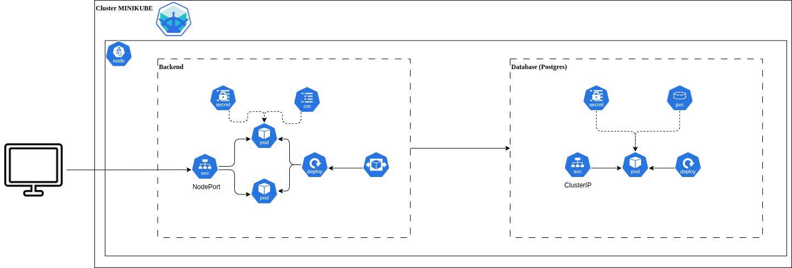
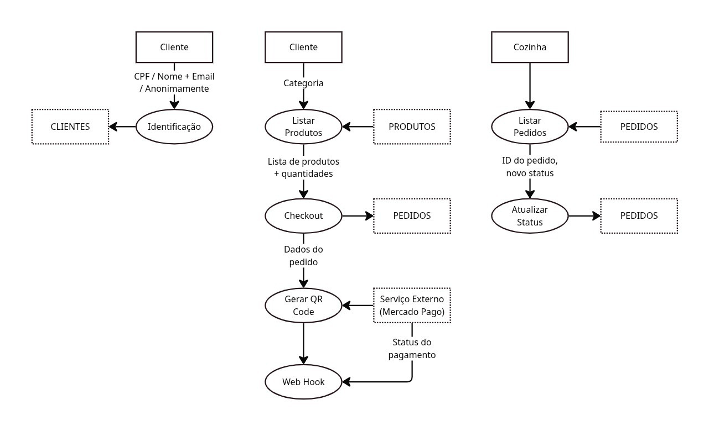

# 🍔 Tech Challenge - Sistema de Autoatendimento para Fast Food

## 💡 Sobre o Projeto

Este projeto faz parte do **Tech Challenge - Fase 1** da **Pós-Tech em Software Architecture** da **FIAP**.

O objetivo é desenvolver um **sistema de autoatendimento para uma lanchonete em expansão**, resolvendo problemas relacionados ao controle de pedidos, preparo e entrega. O projeto busca aumentar a eficiência do atendimento ao cliente e garantir a confiabilidade dos pedidos.

## 🧰 Stacks Utilizadas
- Python
- FastAPI
- PostgreSQL
- Alembic
- SQLAlchemy

## 🧱 Pré-requisitos
- Docker
- Minikube (opcional, para orquestração com Kubernetes)
- Kubectl (opcional, para orquestração com Kubernetes)

## 🚀 Como Iniciar o Projeto

Clone o repositório:
```sh
git clone https://github.com/tech-challenge-pos-fiap/tech-challenge.git
cd tech-challenge
```

Construa a imagem Docker:
```sh
make build
```

Rode as migrations do Alembic:
```sh
make migrate
```

Suba o container:
```sh
make up
```

O arquivo **Makefile** possui alguns outros comandos úteis para o projeto.

Com o container rodando, você pode acessar a documentação da API através da URL:
```
http://localhost:8000/docs
```

---

## ☸️ Rodando com Minikube

Para executar o projeto usando o **Minikube**, é necessário que o Minikube esteja instalado e funcionando corretamente.

1. Gere os manifests Kubernetes:
```sh
make generate-manifests
```

2. Configure o ambiente no Minikube:
```sh
make setup-kube
```

Após isso, o ambiente será provisionado no seu cluster local utilizando os arquivos gerados.

Você pode verificar os serviços ativos com:
```sh
kubectl get services
```

E acessar a aplicação pela URL exposta pelo serviço correspondente no Minikube.

## 🧱 Arquitetura do Projeto - Clean Architecture

Este projeto foi desenvolvido seguindo os princípios da **Clean Architecture**, proposta por Robert C. Martin (Uncle Bob). Essa abordagem favorece a separação de responsabilidades, tornando o código mais modular, testável e de fácil manutenção.

Abaixo, a estrutura do projeto e uma breve explicação de cada diretório:

### 📁 Diretórios

| Diretório                        | Descrição |
|----------------------------------|-----------|
| `app/domain`                    | Camada de domínio, onde estão os **modelos de negócio puros** e **lógica essencial**. |
| `app/domain/entities`          | Contém as **entidades**, que representam os objetos centrais do negócio. |
| `app/domain/value_objects`     | Contém os **objetos de valor**, que representam conceitos imutáveis com regras próprias. |
| `app/application`              | Define os **casos de uso** da aplicação, orquestrando as regras de negócio. |
| `app/application/ports`        | Interfaces que conectam os casos de uso ao mundo externo. |
| `app/application/use_cases`    | Implementações dos **casos de uso** específicos do negócio. |
| `app/adapters`                 | Camada de adaptação entre o domínio e a infraestrutura (como APIs, UIs, etc). |
| `app/adapters/controllers`     | Controladores responsáveis por **direcionar requisições para os casos de uso**. |
| `app/adapters/gateways`        | Implementações que comunicam o domínio com **serviços externos**. |
| `app/adapters/presenters`      | Responsáveis por **formatar respostas** para o usuário ou sistemas externos. |
| `app/adapters/ports`           | Definições de interfaces de entrada/saída da aplicação. |
| `app/infrastructure`           | Camada com detalhes técnicos da aplicação, como frameworks, bibliotecas e integrações. |
| `app/infrastructure/dependencies` | Gerenciamento de **injeções de dependência**. |
| `app/infrastructure/external`  | Integrações com **serviços externos**, como APIs de terceiros. |
| `app/infrastructure/routes`    | Definições das **rotas** da aplicação. |
| `app/infrastructure/repositories` | Implementações concretas de **repositórios** de dados. |
| `config`                       | Arquivos de **configuração geral** da aplicação. |

### 🧭 Mapa Visual

```
.
├── app
│   ├── domain
│   │   ├── entities
│   │   └── value_objects
│   ├── application
│   │   ├── ports
│   │   └── use_cases
│   ├── adapters
│   │   ├── controllers
│   │   ├── gateways
│   │   ├── presenters
│   │   └── ports
│   └── infrastructure
│       ├── dependencies
│       ├── external
│       ├── routes
│       └── repositories
├── config
├── tests
├── kube
└── README.md
```
## 🏗️ Desenho da Infraestrutura

Abaixo está o desenho da infraestrutura do projeto, ilustrando os principais componentes e suas interações:



---

## 🔁 Diagrama de Fluxo

O diagrama de fluxo apresenta a sequência de processos e o caminho dos dados dentro do sistema:


